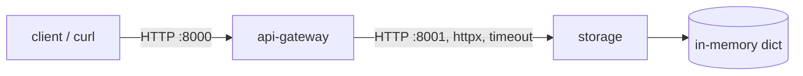

# Архитектура

## Схема взаимодействия



ASCII-вариант:

```
client --HTTP--> [ api-gateway :8000 ] --HTTP (httpx, timeout)--> [ storage :8001 ] --> dict
                  validate, orchestrate,                            domain rules,
                  map errors to 404/409/422/503                     owns the data
```

## Слои (в каждом сервисе)

| Слой | Содержимое | Может импортировать |
|---|---|---|
| api/ | роутеры, Pydantic-схемы | domain |
| domain/ | сущности, сервисы, ошибки, порты (Protocol) | только domain |
| storage/ | адаптеры: dict-репозиторий (storage), HTTP-клиент (gateway) | domain |
| config.py, main.py | настройки, сборка зависимостей (DI) | всё |

Зависимости направлены внутрь: `api -> domain <- storage`. Домен не знает про
FastAPI, httpx и словарь. Порты (`DeviceRepository`, `StorageClient`) описаны в
`domain/ports.py`, реализации подставляются в `main.py` (композиционный корень).
Благодаря этому домен тестируется без сети и БД: репозиторий и клиент
заменяются фейками.

## Обоснование границ сервисов

- **storage** владеет данными и бизнес-правилами устройства: мощность в
  диапазоне (0, 10000], непустые название и комната, уникальность
  "название + комната" без учета регистра, поиск без учета регистра.
- **api-gateway** владеет внешним контрактом: единая точка входа, быстрая
  валидация до сетевого вызова, перевод ошибок соседа в корректные HTTP-коды,
  устойчивость к недоступности storage. Клиент не знает топологию системы.
- Данные есть только у storage (database-per-service): gateway не лезет в
  хранилище напрямую, только через API.
- Разделение продемонстрировано учебно. В реальном проекте при одной команде и
  малой нагрузке хватило бы модульного монолита: микросервисы решают
  организационную проблему, а не проблему производительности.

## Контракты

- Контракт storage: `POST /devices`, `GET /devices/{id}`, `GET /devices/search?q=`;
  ошибки 404/409/422 с телом `{"error", "detail"}`. Он виден в OpenAPI (`/docs`).
- Схемы `DeviceCreate` и `DeviceRead` продублированы в каждом сервисе. Общего
  пакета нет: он связал бы сервисы релизами. Согласованность держится на
  контракте и проверяется сквозным сценарием.
- Gateway переводит ответы storage: 404 -> DeviceNotFound, 409 ->
  DeviceConflict, 422 -> InvalidDevice, 5xx/таймаут/отказ соединения ->
  StorageUnavailable (503).

## Устойчивость

Клиент использует явный `timeout` из `GW_STORAGE_TIMEOUT_S`. `httpx.RequestError`
и ответы 5xx превращаются в `StorageUnavailable`; gateway отвечает 503 с
JSON-телом и пишет одну строку в лог, без трейсбека.

## Конфигурация

pydantic-settings, префиксы `ST_` и `GW_`, значения из окружения или `.env`.
Адреса, порты и таймауты в коде не зашиты. Обязательные поля без значений по
умолчанию дают падение при старте (fail fast). `.env` не коммитится,
в репозитории лежит `.env.example`.

## Ограничения и развитие

- Данные в памяти: теряются при перезапуске, процесс не масштабируется
  горизонтально. Решение: SQLite или внешняя БД.
- Вызов синхронный. Для развязки по времени можно ввести очередь сообщений;
  тогда понадобятся идемпотентные обработчики и итоговая согласованность.
